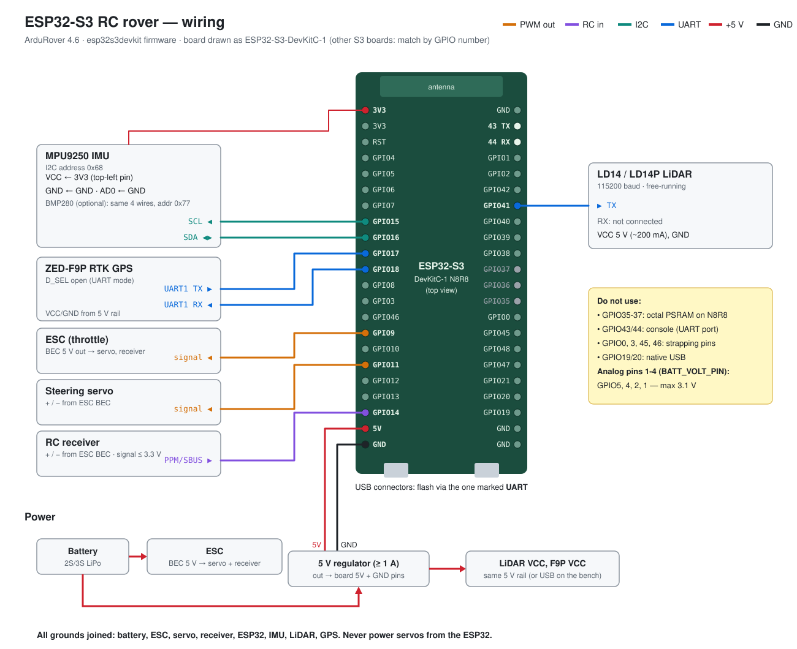
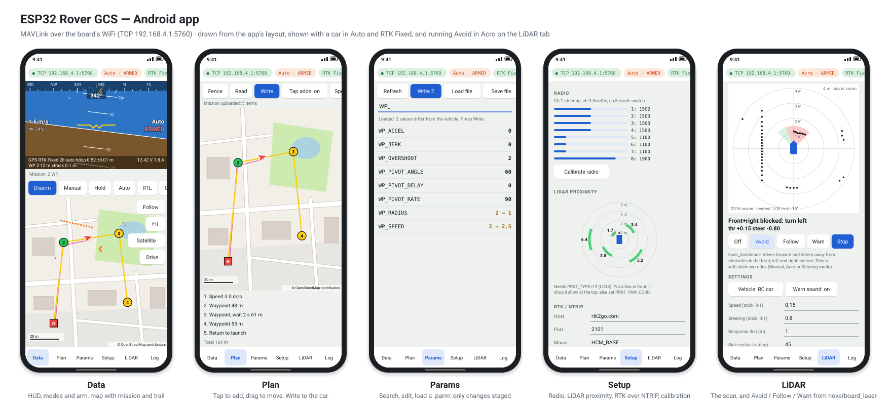

# esp32s3_ardupilot

**English** | [Tiếng Việt](README.vi.md)

ArduPilot (ArduRover 4.6.3) for the **ESP32-S3** (`esp32s3devkit` board) driving an
**RC car** (steering servo + ESC, PPM/SBUS receiver) with an MPU9250 IMU on I2C, and:

- **LDROBOT LD14 / LD14P 360° LiDAR** as a proximity sensor — new `PRX1_TYPE = 19` (LD14)
- **u-blox ZED-F9P RTK GPS**, with NTRIP corrections sent from Mission Planner over WiFi

Based on the upstream [ArduPilot](https://github.com/ArduPilot/ardupilot) `ArduPilot-4.6`
branch at commit `913e171eca7a37549d9f02e442698edfd4490435`. The upstream README is kept
as [README_ArduPilot.md](README_ArduPilot.md).

## Changes from upstream

| File | Change |
| --- | --- |
| `libraries/AP_Proximity/AP_Proximity_LD06.{h,cpp}` | LD14 model: the LD06 packet parser plus the LDROBOT SDK ranging-centre angle correction (the LD14 is a triangulation sensor, its raw angles are off by up to ~7°), 8 m max range, no confidence filter; every rotation is also sent to the ground station as `OBSTACLE_DISTANCE` (72 bins of 5°, about 5 Hz) for the Android app's LiDAR tab |
| `libraries/AP_Proximity/AP_Proximity.{h,cpp}`, `AP_Proximity_Params.cpp` | `PRX_TYPE` 19 = LD14 |
| `libraries/AP_HAL_ESP32/boards/esp32s3devkit.h` | UART2 (RX GPIO41, TX GPIO42) added so SERIAL2 exists; MPU9250 IMU moved from SPI to I2C (0x68) and SPI removed, since GPIO33-37 belong to the octal PSRAM on N8R8/N16R8 modules; SD card disabled, since on the S3 it takes GPIO14/15/2 (RC input, I2C SCL, analog pin 3); ADC channel names updated for ESP-IDF 5.3 (`ADC1_CHANNEL_n` → `ADC_CHANNEL_n`), without which the board does not compile; fences, object avoidance and path planning (BendyRuler, Dijkstra's) turned on |
| `libraries/AP_HAL/board/esp32.h` | The ESP32 defaults that leave out fences, avoidance and path planning can be overridden by a board header |
| `esp32s3_rover_ld14_f9p.parm` | Parameters for the RC car (servo, ESC, receiver, modes), the LiDAR, the F9P and RTK injection |
| `esp32s3-env.sh` | ESP-IDF environment for an S3-only toolchain install |

## Wiring



| Device | Pin | ESP32-S3 | ArduPilot port |
| --- | --- | --- | --- |
| Steering servo | signal | GPIO11 | SERVO1 |
| ESC | signal | GPIO9 | SERVO3 |
| (spare outputs) | | GPIO10, 8, 7, 6 | SERVO2, 4, 5, 6 |
| RC receiver | PPM or SBUS out | GPIO14 | RCIN |
| MPU9250 IMU | SDA / SCL | GPIO16 / GPIO15 | I2C bus 0, address 0x68 |
| BMP280 baro (optional) | SDA / SCL | GPIO16 / GPIO15 | I2C bus 0, address 0x77 |
| LD14 LiDAR | TX | GPIO41 | SERIAL2 (UART2) |
| LD14 LiDAR | RX | not connected | |
| ZED-F9P | UART1 TX | GPIO17 | SERIAL3 (UART1) |
| ZED-F9P | UART1 RX | GPIO18 | SERIAL3 (UART1) |
| all | GND | GND | |

- Power the servo and receiver from the ESC's BEC; join its ground to the ESP32's. Never power servos from the ESP32.
- Analog inputs (for `BATT_VOLT_PIN` etc.): analog pins 1-4 = GPIO5, 4, 2, 1, through a divider to below 3.1 V.
- No SD card: parameters are stored in the ESP32's flash. `LOG_BACKEND_TYPE=2` streams logs over MAVLink.
- Power the LiDAR (5 V, ~200 mA) from the robot's 5 V rail, not from the DevKit's 5V pin while on USB.
- ZED-F9P: leave **D_SEL** open/high. Pulled low it selects SPI and turns UART1 off; ArduPilot has no SPI GPS support.
- SERIAL1 is MAVLink over WiFi (Mission Planner connects to the board's access point).

## Build

```bash
git clone https://github.com/quangvu16/esp32s3_ardupilot.git
cd esp32s3_ardupilot
git submodule update --init --depth 1 --recursive modules/waf modules/mavlink \
    modules/DroneCAN/DSDL modules/DroneCAN/dronecan_dsdlc modules/DroneCAN/libcanard modules/DroneCAN/pydronecan

# ESP-IDF v5.3 at the commit ArduPilot pins (Tools/scripts/esp32_get_idf.sh), shallow
mkdir -p modules/esp_idf && cd modules/esp_idf
git init -q && git remote add origin https://github.com/espressif/esp-idf.git
git fetch --depth 1 origin cc3203dc4f087ab41b434afff1ed7520c6d90993 && git checkout -q FETCH_HEAD
git submodule update --init --depth 1 components/bootloader/subproject/components/micro-ecc/micro-ecc \
    components/mbedtls/mbedtls components/lwip/lwip components/esp_wifi/lib components/esp_phy/lib \
    components/esp_coex/lib components/heap/tlsf components/spiffs/spiffs components/json/cJSON
python3 tools/idf_tools.py install xtensa-esp-elf esp-rom-elfs ninja
python3 tools/idf_tools.py install-python-env
~/.espressif/python_env/idf5.3_py3.10_env/bin/pip install empy==3.3.4 pexpect future
cd ../..

source esp32s3-env.sh          # instead of modules/esp_idf/export.sh (which wants every chip's tools)
./waf configure --board esp32s3devkit
./waf rover
```

`install-python-env` needs Python's `venv`/`ensurepip` (`sudo apt install python3-venv`).
Adjust the `idf5.3_py3.10_env` name in `esp32s3-env.sh` if your Python is not 3.10.

## Flash

### What you need

- The ESP32-S3 DevKit and a USB **data** cable (some cables only carry power).
- Firmware from the [Releases](https://github.com/quangvu16/esp32s3_ardupilot/releases) page.
  For a first flash you only need `ardurover-esp32s3devkit-factory.bin`.
- `esptool`, Espressif's flashing tool: `pip install esptool` (any OS with Python 3).
  Or flash from the browser, with no install (option C below).

Use the DevKit's port labelled **UART** (next to the USB-to-serial chip, CP2102 or CH343):
it flashes reliably and shows ArduPilot's boot messages. The port labelled **USB** also
flashes, but ArduPilot's console is not on it.

| Release file | Flash at | When |
| --- | --- | --- |
| `ardurover-esp32s3devkit-factory.bin` | `0x0` | First flash; bootloader + partition table + firmware in one file |
| `ardurover-esp32s3devkit.bin` | `0x20000` | Updates (firmware only) |
| `bootloader.bin`, `partition-table.bin` | `0x0`, `0x10000` | Only if you flash the three parts separately |

Flash layout: 8 MB, DIO, 80 MHz. Parameters are stored at `0x320000`, beyond the firmware, so
flashing either image **keeps your parameters**. Only `erase_flash` clears them.

### A. Linux

```bash
# 1. let your user open serial ports (once; log out and back in afterwards)
sudo usermod -aG dialout $USER

# 2. check the download
sha256sum -c SHA256SUMS --ignore-missing

# 3. plug in the UART port and find it: usually /dev/ttyUSB0 (or /dev/ttyACM0)
ls /dev/ttyUSB* /dev/ttyACM*

# 4. first flash only: erase everything (also clears old parameters)
python3 -m esptool --chip esp32s3 --port /dev/ttyUSB0 erase_flash

# 5. flash
python3 -m esptool --chip esp32s3 --port /dev/ttyUSB0 -b 460800 \
    write_flash 0x0 ardurover-esp32s3devkit-factory.bin
```

### B. Windows

1. Install the USB-serial driver if the board doesn't show up: CP210x (Silicon Labs) or CH343
   (WCH), whichever chip is next to the UART port.
2. Plug in the UART port. Find its **COM** number in Device Manager → Ports (COM & LPT).
3. In a Command Prompt, in the folder with the downloaded files (replace `COM5`):
   ```bat
   certutil -hashfile ardurover-esp32s3devkit-factory.bin SHA256
   python -m esptool --chip esp32s3 --port COM5 erase_flash
   python -m esptool --chip esp32s3 --port COM5 -b 460800 write_flash 0x0 ardurover-esp32s3devkit-factory.bin
   ```
   Compare the certutil hash with the line in `SHA256SUMS`. Skip `erase_flash` if you want to
   keep your parameters.

### C. From the browser (no install)

1. Open https://espressif.github.io/esptool-js/ in **Chrome or Edge**.
2. Baudrate `460800` → **Connect** → choose the board's serial port.
3. Flash Address `0x0`, choose `ardurover-esp32s3devkit-factory.bin` → **Program**.
   (**Erase Flash** first for a clean start.)

### Updating later

Flash only the firmware. Parameters and calibration are kept:

```bash
python3 -m esptool --chip esp32s3 --port /dev/ttyUSB0 -b 460800 write_flash 0x20000 ardurover-esp32s3devkit.bin
```

### Check that it works

1. Press **RST** (or unplug and replug).
2. A WiFi network **`ardupilot123`** should appear within ~10 s. Connect Mission Planner over
   TCP to `192.168.4.1:5760` and go on to [Set up](#set-up).
3. To see the boot messages, open the UART port at 115200 baud:
   ```bash
   python3 -m serial.tools.miniterm /dev/ttyUSB0 115200     # Ctrl+] to quit
   ```

### Troubleshooting

| Problem | Fix |
| --- | --- |
| `Failed to connect to ESP32-S3: No serial data received` | Put it in download mode by hand: hold **BOOT**, press and release **RST**, release **BOOT**, then run the command again. Press **RST** after flashing. |
| `Permission denied: '/dev/ttyUSB0'` | Linux: `sudo usermod -aG dialout $USER`, then log out and back in. |
| No serial port appears | Try another cable (it must carry data) and the other USB port. On Windows install the CP210x/CH343 driver. |
| Port busy | Close Mission Planner, Arduino IDE, miniterm or anything else using the port. |
| Flashing stops partway | Lower the speed: `-b 115200`. |
| Boot loop, or no WiFi after flashing | Run `erase_flash`, then flash the factory image again. |
| Mission Planner can't connect | Your PC must be on the `ardupilot123` WiFi. Use TCP, not UDP, to `192.168.4.1` port `5760`. |

### Flashing your own build

After `./waf rover` (see [Build](#build)), with the board on the UART port:

```bash
./waf rover --upload
# or
cd build/esp32s3devkit/esp-idf_build
python -m esptool --chip esp32s3 -b 460800 write_flash --flash_mode dio --flash_freq 80m --flash_size 8MB \
  0x0 bootloader/bootloader.bin 0x10000 partition_table/partition-table.bin 0x20000 ardupilot.bin
```

## Set up

ArduRover parameters for the RC car, in the order to set them. Parameter names are
those of ArduRover 4.6; wiring is [above](#wiring).

### 0. Connect

1. Power the ESP32-S3. It creates its own WiFi network **`ardupilot123`** (password `ardupilot123`).
2. Join that network from your PC. In Mission Planner choose **TCP** → `192.168.4.1`, port `5760`.
3. **Config → Full Parameter List → Load from file** → [`esp32s3_rover_ld14_f9p.parm`](esp32s3_rover_ld14_f9p.parm)
   → **Write Params**. Reboot the board and reconnect.

### 1. Mandatory hardware (Setup → Mandatory Hardware)

| Step | What to do |
| --- | --- |
| Frame type | Already set: `FRAME_CLASS=1` (Rover) |
| Accel calibration | Put the board **fixed in the car** first, then do the 6-position calibration. If the board isn't mounted arrow-forward and flat, set `AHRS_ORIENTATION` before calibrating. |
| Compass | Run the calibration by rotating the car in every direction. If no compass is found (many "MPU9250" boards are really an MPU6500), see [step 5](#5-heading-if-theres-no-working-compass). |
| Radio calibration | Move every stick and switch to its ends. Check that channel 1 = steering, channel 3 = throttle, channel 8 = mode switch. |
| Flight modes | Already set on channel 8: Manual / Auto / RTL. Add **Hold** as a safe position, e.g. `MODE2=4`. |

### 2. Steering and throttle checks (wheels off the ground, Manual mode)

| Problem | Fix |
| --- | --- |
| Stick right turns the wheels left | `SERVO1_REVERSED=1` |
| Car isn't straight at centre stick | Change `SERVO1_TRIM` in small steps (around 1500) |
| Steering servo hits its end stops | Narrow `SERVO1_MIN` / `SERVO1_MAX` until it doesn't strain |
| Throttle forward drives backwards | `SERVO3_REVERSED=1` |
| Wheels creep at centre throttle | Calibrate the ESC's neutral (most car ESCs learn it at power-up with the throttle at centre). Keep `SERVO3_TRIM=1500` |
| Motor needs a lot of throttle before it moves | Raise `MOT_THR_MIN` (%) until a small stick movement just starts the car rolling |
| Car accelerates too hard | `MOT_SLEWRATE` (%/s, e.g. 100) |

**Arming:** throttle at centre (zero) and steering **full right for 2 seconds**. Disarm with
full left. Do your first arm with the wheels in the air.

### 3. Failsafes (set before driving on the ground)

| Parameter | Value | Why |
| --- | --- | --- |
| `FS_THR_ENABLE` | `1` | React when the RC signal is lost |
| `FS_THR_VALUE` | `910` | Set your **receiver's own failsafe** so channel 3 drops below this (e.g. 900 µs) when the transmitter is off |
| `FS_GCS_ENABLE` | `1` | React when the WiFi link to Mission Planner drops |
| `FS_ACTION` | `2` (Hold) | Stop. `1` = RTL, but only use that after GPS works well |
| `FS_TIMEOUT` | `1.5` | Seconds before the failsafe triggers |
| `FS_CRASH_CHECK` | `2` | Hold and disarm if the car is stuck against something |

Test it: arm with the wheels off the ground, switch the transmitter off, and check that the
wheels stop.

### 4. GPS (ZED-F9P)

Already set in the parameter file. Check that Mission Planner shows `3D Fix` outdoors. For RTK,
use **Setup → Optional Hardware → RTK/GPS Inject → NTRIP** (caster, port, usually 2101,
mountpoint, user, password). The status goes 3D Fix → RTK Float → RTK Fixed. ArduPilot sets
up the F9P itself because `GPS_AUTO_CONFIG=1`.

### 5. Heading if there's no working compass

If the compass is missing, or upset by the motor and its wires:

```
COMPASS_ENABLE = 0
EK3_SRC1_YAW   = 8     # GSF: heading estimated from GPS while the car moves
```

The car must drive straight a few metres after arming before Auto mode has a good heading.
With a working compass, keep `COMPASS_ENABLE=1` and mount the board away from the motor and
battery wires.

### 6. Battery monitor (optional)

Connect the battery through a resistor divider to GPIO5 (analog pin 1), keeping the pin below 3.1 V:

```
BATT_MONITOR    = 3     # analog voltage only
BATT_VOLT_PIN   = 1
BATT_VOLT_MULT  = ...   # adjust until Mission Planner's voltage matches a multimeter
BATT_LOW_VOLT   = ...   # e.g. 3.5 V x number of cells
BATT_FS_LOW_ACT = 2     # Hold
```

### 7. Tuning (outdoors, open space)

Work in this order. Mission Planner's **Config → Tuning** page and the live graphs
(Ctrl-F → Tuning) show requested vs actual values. Logs need `LOG_BACKEND_TYPE=2`
(log over MAVLink), since there's no SD card.

1. **Cruise throttle.**
   - Set `RC7_OPTION=50` (Learn Cruise) on a switch.
   - Drive straight in Manual at a steady speed, then flip the switch. `CRUISE_SPEED` and
     `CRUISE_THROTTLE` are set from that run.
2. **Turn rate (Acro mode, e.g. `MODE3=1`).**
   - `TURN_RADIUS`: your car's tightest turn in metres (default 0.9).
   - `ATC_STR_RAT_MAX`: highest turn rate you want, in °/s (e.g. 120).
   - `ATC_STR_RAT_FF`: raise it until the actual turn rate follows the requested rate. Then
     add a little `ATC_STR_RAT_P` (~0.1–0.2) and `ATC_STR_RAT_I` (similar).
3. **Speed control (Acro mode).**
   - Start with `ATC_SPEED_P=0.2` and `ATC_SPEED_I=0.2`. Raise them until the speed holds
     without surging.
   - `ATC_ACCEL_MAX` and `ATC_DECEL_MAX` in m/s², e.g. 1.0 for gentle driving.
4. **Navigation (Auto mode).**
   - `WP_SPEED`: driving speed in m/s.
   - `WP_RADIUS`: how close counts as "arrived" (≥ `TURN_RADIUS`; with RTK, 0.5 m works).
   - `WP_ACCEL`: 0 = use `ATC_ACCEL_MAX`.
   - If it cuts corners or swings wide, look first at `TURN_RADIUS` and `ATC_STR_ANG_P`.

### 8. Obstacle avoidance with the LiDAR (last)

ArduPilot has four ways to avoid obstacles. They are described in its
[Object Avoidance](https://ardupilot.org/rover/docs/common-object-avoidance-landing-page.html#avoidance-strategies) pages.
This firmware includes all four. Upstream ArduPilot leaves fences and avoidance out of ESP32
builds; `esp32s3devkit.h` turns them back on.

| Strategy | Avoids | Works in | Main setting |
| --- | --- | --- | --- |
| [Simple Object Avoidance](https://ardupilot.org/rover/docs/common-simple-object-avoidance.html) | LiDAR obstacles and fences, by **stopping** | Acro, Steering, Loiter, Simple, Circle | `AVOID_ENABLE` |
| [BendyRuler](https://ardupilot.org/rover/docs/common-oa-bendyruler.html) | LiDAR obstacles and fences, by **driving around** them | Auto, Guided, RTL | `OA_TYPE = 1` |
| [Dijkstra's](https://ardupilot.org/rover/docs/common-oa-dijkstras.html) | **Fences only**: plans the shortest path around them (ignores the LiDAR) | Auto, Guided, RTL | `OA_TYPE = 2` |
| [Dijkstra's with BendyRuler](https://ardupilot.org/rover/docs/common-oa-dijkstrabendyruler.html) | Both: Dijkstra's around fences, BendyRuler when the LiDAR sees something | Auto, Guided, RTL | `OA_TYPE = 3` |

None of them works in **Manual** or **Hold**.

**1. Point the LiDAR the right way.** Put an object in front of the car. In the proximity view
(Ctrl-F → Proximity, or the app's Setup tab), set `PRX1_YAW_CORR` so that the object shows at
0°. Otherwise the car avoids obstacles where they aren't.

**2. Simple Object Avoidance.** The car stops before an obstacle or a fence. Use it on its own,
or together with one of the planners.

```
AVOID_ENABLE = 3     # bit 0 fence + bit 1 proximity (LiDAR)
AVOID_MARGIN = 0.5   # m kept from obstacles
AVOID_BEHAVE = 1     # Stop (the Rover default)
```

Test it in **Acro** or **Steering**, slowly: the car should refuse to drive into a box.

**3. Choose a path planner** for Auto, Guided and RTL (reboot after changing `OA_TYPE`, then
refresh the parameters to see the `OA_BR_` and `OA_DB_` ones):

```
OA_TYPE          = 1    # 1 BendyRuler, 2 Dijkstra's, 3 Dijkstra's with BendyRuler
OA_MARGIN_MAX    = 2    # m kept from obstacles and fences (default 5); keep it above WP_RADIUS
OA_BR_LOOKAHEAD  = 5    # m probed ahead (BendyRuler); keep it under the LD14's 8 m range
OA_DB_DIST_MAX   = 8    # m: ignore LiDAR points further away than the LD14 can measure
```

- **BendyRuler** is the one to start with: it only needs the LiDAR.
- **Dijkstra's** only knows about fences. Draw them first (step 4). It does not see the LiDAR,
  so pair it with `AVOID_ENABLE` or use type 3.
- **Dijkstra's with BendyRuler** follows the shortest path around fences and switches to
  BendyRuler while the LiDAR sees an obstacle.
- Keep `OA_MARGIN_MAX` larger than `WP_RADIUS` (default 2 m). The car counts a waypoint as reached
  `WP_RADIUS` early and cuts the corner, so a smaller margin lets it clip a fence corner, breach it and
  stop in Hold. In SITL, margin 2 with `WP_RADIUS` 2 touched a stay-out box; margin 3 with
  `WP_RADIUS` 1 went cleanly around it.
- **Among obstacles** (patrolling with BendyRuler; the apps' *Patrol… → Set up BendyRuler* writes
  these): `OA_MARGIN_MAX` 2, `WP_RADIUS` 1, `AVOID_MARGIN` 1, `WP_SPEED` 1. Tested in SITL's field of
  posts 8 m apart: a 3 m margin left no way between them, `AVOID_MARGIN` 2 (the default) stopped the
  car before BendyRuler could steer, and at 2 m/s a turn carried the car into a post. With these it
  drove round the posts (0.5-1.6 m at the closest), but once it stopped 1 m in front of a post and
  stayed: watch a patrol and take over if it stalls. Keep waypoints further than `OA_MARGIN_MAX` from
  obstacles: BendyRuler can't reach one inside the margin and wanders. More in the
  [guide](docs/GUIDE.md#6-patrol-with-the-lidar).

**4. Fences** (for Dijkstra's, and for simple avoidance's fence bit). Draw stay-in (inclusion)
and stay-out (exclusion) polygons or circles, then upload them: in the
[Android app](android_gcs/README.md#fences), **Plan → Fence**, or in Mission Planner, **Plan → Fence**.
Then set (the app's **Enable…** button does this):

```
FENCE_ENABLE = 1
FENCE_TYPE   = 6     # circle around home + polygons
FENCE_RADIUS = 50    # m, circle around home
FENCE_ACTION = 2     # Hold on a breach
```

The board's parameter storage holds about 80 fence points. Keep waypoints a few metres away from
fence edges.

**5. Try it** on an open field at a low `WP_SPEED`, in Auto: put a box on the route and watch
the car go around it. If it hesitates or swings, see the BendyRuler page (`OA_BR_CONT_RATIO`,
`OA_BR_CONT_ANGLE`).

### Checklist before every drive

- [ ] Mode switch on Manual or Hold
- [ ] GPS 3D Fix (or RTK) and EKF status green
- [ ] Receiver failsafe tested
- [ ] Battery charged, and the car on the ground only once directions are confirmed

## Android app

[`android_gcs/`](android_gcs/README.md) is a small Mission Planner for the phone. Join the
`ardupilot123` WiFi and the app connects to `192.168.4.1:5760` by itself. It has:

- a HUD, a map, mode buttons and arming, and a phone stick for driving
- waypoint planning, with Mission Planner `.waypoints` files; zig-zag lanes from points A and B;
  patrol (the plan in a loop, with BendyRuler steering round what the LiDAR sees)
- the full parameter list, with `.parm` load and save
- accelerometer, compass and radio calibration
- the LiDAR scan, and the hoverboard robot's `hoverboard_laser` behaviours for the car: Avoid, Follow and Warn
- RTK corrections over NTRIP, using the phone's mobile data

A [Windows version](android_gcs/desktop/README.md) has the same map, missions, zig-zag, patrol,
fences, LiDAR tab and parameters (calibration and RTK stay with Mission Planner on a PC).
**How to use all of it: the [guide](docs/GUIDE.md).**

**Download:** [esp32-rover-gcs-1.2.apk](https://github.com/quangvu16/esp32s3_ardupilot/releases/download/gcs-v1.2/esp32-rover-gcs-1.2.apk) (Android 8.0 or newer), from the
[gcs-v1.2 release](https://github.com/quangvu16/esp32s3_ardupilot/releases/tag/gcs-v1.2). Open it on the phone and allow "install unknown apps".
To build it yourself, see the app's README.



## License

GPLv3, the same as ArduPilot — see [LICENSE](LICENSE).
