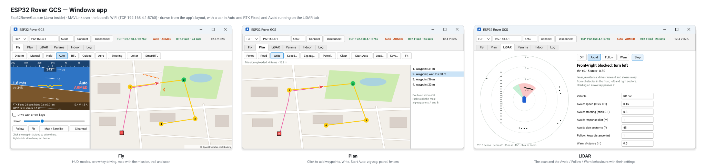
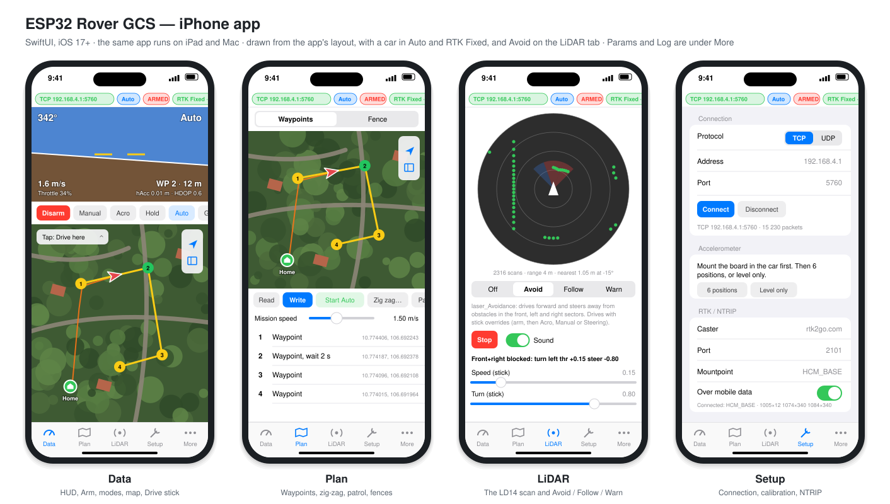
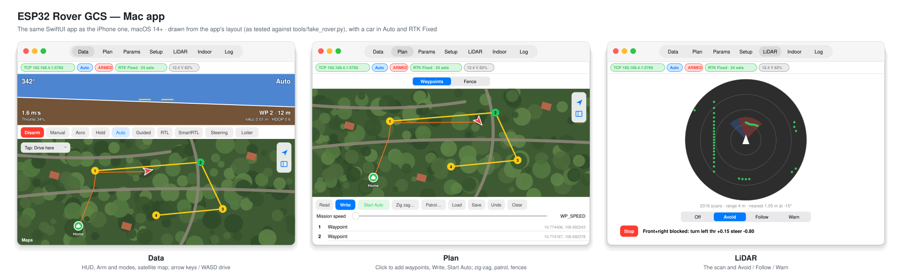
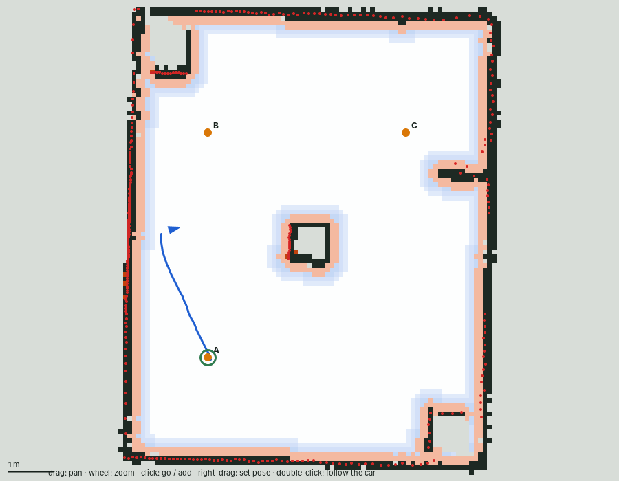

# ESP32-S3 Rover: hướng dẫn sử dụng

[English](GUIDE.md) | **Tiếng Việt**

Cách dùng ArduRover của repo này trên xe RC, từ lần kết nối đầu tiên tới chạy zig-zag, tuần tra và
LiDAR. Biên dịch, nạp firmware, đấu dây và toàn bộ tham số nằm trong [README.vi.md](../README.vi.md);
hướng dẫn này nói về việc điều khiển xe. Tên nút và tham số được giữ bằng tiếng Anh, đúng như trên
màn hình ứng dụng.

Có bốn ứng dụng trạm mặt đất dùng chung một lõi: Android, Windows, iPhone/iPad và Mac.


<details><summary>Ứng dụng Windows, iPhone và Mac</summary>







</details>

## Mục lục

1. [Bạn có gì](#1-bạn-có-gì)
2. [Kết nối](#2-kết-nối)
3. [Lái bằng tay](#3-lái-bằng-tay)
4. [Lộ trình (mission)](#4-lộ-trình-mission)
5. [Zig-zag](#5-zig-zag)
6. [Tuần tra với LiDAR](#6-tuần-tra-với-lidar)
7. [Hàng rào (fence)](#7-hàng-rào-fence)
8. [Hành vi LiDAR: Avoid, Follow, Warn](#8-hành-vi-lidar-avoid-follow-warn)
9. [GPS RTK](#9-gps-rtk)
10. [Xử lý sự cố](#10-xử-lý-sự-cố)
11. [Trước mỗi lần chạy](#11-trước-mỗi-lần-chạy)
12. [Tập luyện không cần xe](#12-tập-luyện-không-cần-xe)
13. [Trong nhà không GPS (LiDAR SLAM)](#13-trong-nhà-không-gps-lidar-slam)
14. [Tự hành trong nhà trên ứng dụng: bản đồ, chạm để đi, tuần tra](#14-tự-hành-trong-nhà-trên-ứng-dụng-bản-đồ-chạm-để-đi-tuần-tra)

## 1. Bạn có gì

| Phần | Là gì | Ở đâu |
| --- | --- | --- |
| Firmware | ArduRover 4.6.3 cho ESP32-S3 với LiDAR LD14, RTK ZED-F9P, tránh vật cản và hàng rào | [Releases](https://github.com/quangvu16/esp32s3_ardupilot/releases), README.vi.md [Nạp firmware](../README.vi.md#nạp-firmware) |
| Ứng dụng Android | Trạm mặt đất trên điện thoại: bản đồ, lộ trình, zig-zag, tuần tra, hàng rào, LiDAR, tham số, hiệu chuẩn, RTK | [android_gcs](../android_gcs/README.md), APK trong các bản phát hành `gcs-v…` |
| Ứng dụng Windows | Như trên, chạy trên máy tính (không có hiệu chuẩn và RTK: dùng Mission Planner). `Esp32RoverGcs.exe` có sẵn Java bên trong | [android_gcs/desktop](../android_gcs/desktop/README.md), workflow *Windows app (exe)* / bản phát hành |
| Ứng dụng iPhone, iPad và Mac | Một ứng dụng SwiftUI: các tab như ứng dụng Android, có cả hiệu chuẩn và RTK; trên Mac lái bằng phím mũi tên | [apple_gcs](../apple_gcs/README.md), biên dịch bằng Xcode |
| Mission Planner | Vẫn dùng được: TCP `192.168.4.1:5760` | [ardupilot.org](https://ardupilot.org/planner/) |

WiFi của board chỉ phục vụ tốt một trạm mặt đất mỗi lúc. Hãy đóng các trạm khác trước khi chạy xe.

### Cài các ứng dụng

| Ứng dụng | Cách cài |
| --- | --- |
| Android | Tải APK từ bản phát hành `gcs-v…` mới nhất, mở trên điện thoại và cho phép *cài ứng dụng không rõ nguồn*. |
| Windows | `Esp32RoverGcs-<phiên bản>.exe` cài cho người dùng hiện tại (menu Start *ESP32 Rover* và lối tắt trên desktop); hoặc giải nén `…-windows-portable.zip` rồi chạy `Esp32RoverGcs\Esp32RoverGcs.exe`. Không cần cài Java. Lần đầu: SmartScreen chọn *More info → Run anyway*; tường lửa: cho phép *Private networks*. |
| Mac | Mở `apple_gcs/Esp32RoverGcs.xcodeproj` bằng Xcode, chọn **My Mac**, **Product → Run**. Không cần tài khoản Apple. Lần đầu macOS có thể chặn: System Settings → Privacy & Security → **Open Anyway**. |
| iPhone / iPad | Xcode → Settings → Accounts: thêm Apple ID. Project → Signing & Capabilities → Team: *tên bạn (Personal Team)*. Cắm iPhone bằng cáp, bật Settings → Privacy & Security → **Developer Mode**, chọn iPhone trong Xcode rồi **Run**. Trên iPhone: Settings → General → VPN & Device Management → Apple ID của bạn → **Trust**. Với Apple ID miễn phí, cứ 7 ngày phải chạy lại từ Xcode. |

Chi tiết: [apple_gcs/README](../apple_gcs/README.md), [README ứng dụng Windows](../android_gcs/desktop/README.md).

## 2. Kết nối

1. Cấp nguồn cho xe. Trong khoảng 10 giây ESP32-S3 phát WiFi **`ardupilot123`** (mật khẩu `ardupilot123`).
2. Cho điện thoại hoặc máy tính vào mạng đó.
   - **Android** báo mạng không có internet: chọn *vẫn kết nối*. Dữ liệu di động vẫn bật cho bản đồ
     và RTK; ứng dụng tự gửi MAVLink qua WiFi.
   - **Windows** và **Mac**: WiFi này cũng không có internet, đó là bình thường.
   - **iPhone / iPad**: vẫn ở lại mạng khi iOS báo không có internet. Lần đầu mở ứng dụng, cho phép
     **Local Network** (mạng cục bộ); nếu không, ứng dụng không tới được `192.168.4.1` (đổi lại trong
     Settings → Privacy & Security → Local Network). Dữ liệu di động vẫn bật cho bản đồ và RTK.
3. Mở ứng dụng. Nó tự kết nối tới TCP `192.168.4.1:5760`. Mục đầu tiên trên thanh trạng thái chuyển
   sang màu xanh.

Chỉ lần đầu: nạp [`esp32s3_rover_ld14_f9p.parm`](../esp32s3_rover_ld14_f9p.parm) (Params → Load), ghi
vào xe, khởi động lại, rồi hiệu chuẩn gia tốc kế, la bàn và tay điều khiển (Android: tab Setup; hoặc
Mission Planner). Thứ tự và cách kiểm tra xem phần [Cài đặt tham số](../README.vi.md#cài-đặt-tham-số).

## 3. Lái bằng tay

- **Arm**: nút Arm (Android: nhấn giữ để ép arm), hoặc tay điều khiển (ga ở giữa, lái hết bên phải
  2 giây). Disarm cũng vậy, hoặc lái hết bên trái.
- **Chế độ**: Manual (cần điều khiển trực tiếp), Acro (cần = tốc độ và tốc độ quay; về 0 là phanh),
  Hold (dừng), Auto (chạy lộ trình), Guided (tới một điểm), RTL (về home).
- **Không có tay điều khiển**: cần **Drive** của ứng dụng Android và iPhone (tab Data → Drive), hoặc
  phím mũi tên / W A S D của ứng dụng Windows (tích *Drive with arrow keys*) và ứng dụng Mac (mở
  **Drive**). Tất cả gửi lệnh ghi đè cần điều khiển, có tác dụng ở Manual, Acro và Steering; *Power*
  giới hạn mức tối đa. Thả tay là gửi lệnh về 0; trên máy tính và Mac, phím đang giữ bị bỏ khi cửa sổ
  mất focus. Nếu ứng dụng ngừng gửi, sau `RC_OVERRIDE_TIME` (3 giây)
  xe quay lại nghe tay điều khiển.
- **Guided**: chuyển sang Guided, rồi chạm (bấm) lên bản đồ ở chỗ muốn xe tới. (iPhone và Mac: menu
  *Tap* trên bản đồ chọn việc mỗi lần chạm: tới đây, thêm waypoint, hoặc dời home.)

Lần chạy đầu tiên hãy nhấc bánh xe khỏi mặt đất.

## 4. Lộ trình (mission)

Ở tab **Plan**: chạm (bấm) lên bản đồ để thêm waypoint, kéo để di chuyển, chạm vào một waypoint để sửa
(thời gian chờ, loiter, về home, đổi tốc độ, thứ tự). **Write** gửi lộ trình xuống xe, **Read** đọc lộ
trình đang có trên xe. **Start Auto** chạy từ mục đầu tiên. Đọc và lưu được file `.waypoints` của
Mission Planner.

Các tham số quan trọng: `WP_SPEED` (m/s), `WP_RADIUS` (bao gần thì coi là đã tới: ít nhất
`TURN_RADIUS`; 0,5-1 m khi có RTK), `TURN_RADIUS` (bán kính quay nhỏ nhất của xe).

## 5. Zig-zag

Copter có chế độ ZigZag để phun thuốc và cắt cỏ; Rover không có, nên ứng dụng biến nó thành lộ trình:
xe chạy từ A tới B, dịch sang ngang, chạy ngược lại, cứ thế tiếp, ở chế độ Auto.

1. **Đặt A và B**: lái xe tới một đầu và bấm **A = car here**, rồi tới đầu kia và bấm **B = car here**
   (Plan → **Zig zag…**). Hoặc nhấn giữ (bấm chuột phải) lên bản đồ Plan và chọn *Zig-zag point A/B
   here*. Đường nét đứt màu tím là A→B.
2. **Thiết lập**, đặt tên theo các tham số `ZIGZ_` của Copter:

   | Thiết lập | Ý nghĩa |
   | --- | --- |
   | Line spacing | Khoảng cách giữa các đường (`ZIGZ_SIDE_DIST`) |
   | Lines | Số đường chạy (`ZIGZ_LINE_NUM`) |
   | Side | Bên phải hay bên trái của A→B (`ZIGZ_DIRECTION`) |
   | Wait at ends | Số giây dừng ở cuối mỗi đường (`ZIGZ_WP_DELAY`) |
   | Run-out | Kéo dài thêm qua hai đầu, để xe quay đầu bên ngoài khu vực |

3. **Make lanes** thay lộ trình bằng các đường zig-zag. **Write**, rồi **Start Auto**.

Xe không thể quay đầu trong khoảng nhỏ hơn chừng 2 × `TURN_RADIUS`. Nếu khoảng cách giữa các đường nhỏ
hơn, đặt run-out khoảng `TURN_RADIUS`: xe sẽ vòng ra ngoài khu vực và đã về đúng đường trước khi khu vực
bắt đầu. Đường 1 bắt đầu ngay tại A (không có run-out phía sau xe).

Đã thử trong SITL: 4 đường dài 20 m, cách nhau 4 m, xe chạy lệch mỗi đường không quá 0,14 m; với khoảng
cách 1 m (nhỏ hơn vòng quay đầu 1,8 m) xe vẫn chạy đủ mọi đường, lệch không quá 0,5 m.

## 6. Tuần tra với LiDAR

Tuần tra cho xe chạy lặp lại lộ trình ở chế độ Auto, và **BendyRuler** của ArduPilot lái vòng qua mọi vật
LiDAR thấy trên đường. Vòng lặp là lệnh `DO_JUMP` ở cuối lộ trình, nên xe tự tuần tra tiếp kể cả khi
điện thoại hay máy tính mất kết nối. **Hold** để dừng.

1. **Tạo lộ trình**: các waypoint, hoặc một [zig-zag](#5-zig-zag). Đặt mọi waypoint cách vật cản xa hơn
   `OA_MARGIN_MAX` (2 m): BendyRuler không tới được waypoint nằm trong khoảng cách đó và sẽ đi lòng vòng,
   trong SITL còn lao vào vật cản.
2. Plan → **Patrol…**: số vòng (0 = mãi mãi) và thời gian dừng ở cuối mỗi vòng.
3. **Set up BendyRuler** (một lần). Nút này ghi các thiết lập dưới đây. Các tham số `OA_BR_` chỉ xuất
   hiện sau khi khởi động lại với `OA_TYPE` 1, nên cần **bấm hai lần**: lần đầu ghi `OA_TYPE` và khởi
   động lại board; sau khi kết nối lại, đọc lại tham số (Refresh) rồi bấm lần nữa. Hộp thoại báo
   *BendyRuler ready* khi đã đủ.

   | Tham số | Giá trị | Vì sao |
   | --- | --- | --- |
   | `OA_TYPE` | 1 | BendyRuler (3 = kèm Dijkstra's quanh hàng rào) |
   | `OA_MARGIN_MAX` | 2 m | Khoảng cách giữ với vật cản. 3 m không còn lối đi giữa các vật cách nhau 8 m |
   | `WP_RADIUS` | 1 m | Nhỏ hơn khoảng cách trên, nếu không xe cắt góc vào chính vật cần tránh |
   | `AVOID_MARGIN` | 1 m | Simple avoidance của ArduPilot làm phanh cuối cùng. Mặc định 2 m dừng xe trước khi BendyRuler kịp lái vòng |
   | `WP_SPEED` | 1 m/s | Ở 2 m/s xe ôm cua lao vào vật cản trước khi kịp phản ứng |
   | `OA_BR_LOOKAHEAD` | 5 m | BendyRuler nhìn trước bao xa; nhỏ hơn tầm 8 m của LD14 |
   | `OA_DB_DIST_MAX` | 8 m | Tầm đo của LD14 |

4. **Make patrol**, **Write**, **Start Auto**. HUD hiện *Lap n/N* (vòng thứ n trên N).

Phải cài LiDAR trước (`PRX1_TYPE` 19, đã kiểm tra `PRX1_YAW_CORR`: đặt một cái hộp phía trước, nó phải
hiện ở phía trên của tab LiDAR).

**Đã thử trong SITL** với LiDAR mô phỏng và một bãi cột bán kính 1 m cách nhau 10 m: tuần tra 2 vòng,
chặng đầu đi thẳng qua ba cột (không có BendyRuler thì xe đi xuyên qua chúng). Với các thiết lập trên,
xe đi vòng qua các cột, lúc gần nhất cách cột 0,5-1,6 m, và lặp sang vòng 2. **Nhưng xe có thể bị kẹt:**
trong một lần chạy, xe rời waypoint và hướng thẳng vào một cột, simple avoidance dừng xe cách cột 1 m,
và vì đang ở trong khoảng 2 m của BendyRuler nên BendyRuler không tìm được đường ra, xe đứng yên ở đó.
Xe ô tô không quay tại chỗ được. Vì vậy:

- theo dõi khi tuần tra, và lấy lại quyền điều khiển (Hold, rồi Manual) nếu xe dừng trước vật cản;
- không cho xe chạy thẳng vào vật cản từ gần (một waypoint đặt vài mét ngay trước vật cản);
- đặt waypoint ở chỗ trống, cách mọi vật xa hơn `OA_MARGIN_MAX`.

## 7. Hàng rào (fence)

Plan → **Fence**. **+ Stay-in** (vùng được ở trong) / **+ Stay-out** (vùng cấm vào), rồi chạm vào các
góc (3 góc trở lên); **+ Circle**, rồi tâm và bán kính. Kéo góc để di chuyển; chạm vào một góc để có thêm
lựa chọn. **Write** gửi hàng rào xuống xe, **Enable…** bật nó (`FENCE_ENABLE`, `FENCE_TYPE`,
`FENCE_ACTION` = Hold). Khi đó xe không arm được nếu ở ngoài vùng stay-in hoặc trong vùng stay-out, và
dừng (Hold) nếu vượt hàng rào.

Board lưu được khoảng 80 góc. Hàng rào là thứ mà Dijkstra's (`OA_TYPE` 2 hoặc 3) lập đường đi vòng qua:
đặt `OA_MARGIN_MAX` lớn hơn `WP_RADIUS`, nếu không xe sẽ cắt góc vào hàng rào.

## 8. Hành vi LiDAR: Avoid, Follow, Warn

Tab **LiDAR** hiện vòng quét của LD14 nhìn từ trên xuống (firmware v4.6.3-esp32s3-3 trở lên) và chạy
ba hành vi của gói `hoverboard_laser` (robot hoverboard) trên xe:

| Hành vi | Làm gì |
| --- | --- |
| **Avoid** | Chạy tới và lái tránh vật trong vùng phía trước, bên trái và bên phải |
| **Follow** | Bám theo vật gần nhất phía trước, giữ khoảng cách đã đặt |
| **Warn** | Kêu bíp (và rung điện thoại) khi có vật quá gần phía trước; không lái xe |

Chọn một hành vi, bấm **Start**. Avoid và Follow lái bằng lệnh ghi đè cần điều khiển: arm xe và dùng
**Acro** (cần là tốc độ, về 0 là phanh; ở Manual xe trôi tiếp). Cần Drive / phím mũi tên tạm dừng hành
vi; **Stop**, đổi hành vi, rời ứng dụng hoặc mất vòng quét đều dừng xe ngay.

- Đặt `PRX1_TYPE` 19 và kiểm tra `PRX1_YAW_CORR` trước: đặt một cái hộp phía trước xe, nó phải hiện ở
  phía trên của vòng quét.
- Đặt `AVOID_MARGIN` (khoảng cách dừng của chính ArduPilot, bước 8 trong README) nhỏ hơn khoảng cách bám
  theo, nếu không ArduPilot giữ xe lại. Với thiết lập tuần tra (`AVOID_MARGIN` 1 m), đặt khoảng cách
  bám theo của Follow từ 1,3 m trở lên.
- Bắt đầu với tốc độ mặc định (0,15) và chỉ tăng khi xe phản ứng kịp.

Các hành vi này do ứng dụng lái. Để tránh vật cản khi chạy lộ trình, dùng BendyRuler
([tuần tra](#6-tuần-tra-với-lidar)), chạy ngay trên xe.

## 9. GPS RTK

Android, iPhone và Mac: Setup → **RTK / NTRIP**: caster, cổng (2101), mountpoint, user, mật khẩu →
**Start NTRIP**. Trên iPhone giữ *Over mobile data* bật khi điện thoại đang ở WiFi của xe (WiFi đó
không có internet).
Trên máy tính: Mission Planner → Setup → Optional Hardware → RTK/GPS Inject. Trạng thái GPS đi từ 3D fix
→ RTK Float → RTK Fixed. Khi RTK Fixed, `WP_RADIUS` 0,5 m là hợp lý.

## 10. Xử lý sự cố

| Hiện tượng | Kiểm tra |
| --- | --- |
| Ứng dụng không kết nối | Điện thoại hoặc máy tính đang ở WiFi `ardupilot123`; địa chỉ là TCP `192.168.4.1:5760`; không có trạm mặt đất nào khác đang kết nối. iPhone: đã cho phép *Local Network*. Khi không tới được board, trạng thái ghi *no answer: is this device on the car's WiFi?* |
| Ứng dụng iPhone không mở sau một tuần | Ứng dụng ký bằng Apple ID miễn phí hết hạn sau 7 ngày: chạy lại từ Xcode |
| Windows: "Windows protected your PC" | File exe không ký bằng chứng chỉ trả phí: **More info → Run anyway** |
| Không arm được | Tab Log ghi lý do (`PreArm: …`). Hàng rào: xe phải ở trong vùng stay-in |
| Cần / phím mũi tên không có tác dụng | Chế độ phải là Manual, Acro hoặc Steering; `SYSID_MYGCS` phải là 255; xe phải được arm |
| Tab LiDAR không có vòng quét | Firmware v4.6.3-esp32s3-3 trở lên, `PRX1_TYPE` 19, `SERIAL2_PROTOCOL` 11, chân TX của LD14 nối GPIO41 |
| Thiếu tham số `OA_BR_` | Chúng chỉ xuất hiện sau khi khởi động lại với `OA_TYPE` 1; đọc lại tham số sau khi kết nối lại |
| Xe cắt góc vào hàng rào | Tăng `OA_MARGIN_MAX` lớn hơn `WP_RADIUS` |
| Xe tự dừng ở Hold | Vượt hàng rào (`FENCE_ACTION`), failsafe (`FS_…`) hoặc hết lộ trình: xem tab Log |

## 11. Trước mỗi lần chạy

- [ ] Công tắc chế độ ở Manual hoặc Hold
- [ ] GPS 3D fix (hoặc RTK) và vị trí trên bản đồ hợp lý
- [ ] Đã thử failsafe của tay điều khiển
- [ ] LiDAR: cái hộp phía trước hiện ở phía trên của vòng quét
- [ ] Lần đầu chạy bất cứ thứ gì mới: nhấc bánh xe lên, rồi chạy chậm dưới đất

## 12. Tập luyện không cần xe

[`apple_gcs/tools/fake_rover.py`](../apple_gcs/tools/fake_rover.py) là một ArduRover giả để thử bất
kỳ ứng dụng nào ngay tại bàn. Chỉ cần Python 3:

```bash
python3 apple_gcs/tools/fake_rover.py
```

Rồi cho ứng dụng kết nối tới TCP **`127.0.0.1:5760`** (tab Setup, hoặc ô địa chỉ của ứng dụng
Windows). Nó gửi vị trí trong một công viên với RTK Fixed, vòng quét LiDAR có bốn cột quanh home,
23 tham số, và trả lời arm, chế độ, cần Drive, Guided, lộ trình và hàng rào: ở Auto xe chạy qua các
waypoint rồi dừng ở Hold. Đây chỉ là mô hình đơn giản, không phải mô phỏng xe thật; muốn vậy hãy dùng
ArduPilot SITL.

## 13. Trong nhà không GPS (LiDAR SLAM)

Xe có thể chạy nhiệm vụ trong nhà mà không cần GPS: nó vẽ bản đồ căn phòng bằng LD14 và tự định vị
trong bản đồ đó (khoảng ±10 cm khi thử nghiệm), rồi EKF kết hợp với IMU.

1. Nạp [`esp32s3_rover_ld14_indoor.parm`](../esp32s3_rover_ld14_indoor.parm) sau file thường dùng,
   và đặt `PRX1_SLAM_LAT`, `PRX1_SLAM_LON` theo tọa độ tòa nhà.
2. Khởi động lại khi xe đứng trên vạch xuất phát, luôn quay cùng một hướng. Chờ `SLAM: tracking`.
3. Chạy chậm ở Manual trước, rồi mới Auto.

Cách hoạt động, tham số, độ chính xác, chỉnh EKF cho RTK ngoài trời và xử lý sự cố có trong
[Kết hợp cảm biến: IMU + LiDAR + GPS](SENSOR_FUSION.vi.md).

## 14. Tự hành trong nhà trên ứng dụng: bản đồ, chạm để đi, tuần tra

Tab **Indoor** hoạt động giống Nav2 của ROS 2, ngay trong ứng dụng: bấm **Map new**, lái chậm quanh phòng,
rồi **Save map**. Lần sau bấm **Load map**, chạm vào chỗ muốn xe đến, hoặc thêm các điểm rồi bấm
**Patrol**. Ứng dụng lập đường tránh tường và mọi vật LiDAR thấy, và dừng xe nếu không chắc xe đang ở
đâu. Cần các tham số trong nhà ở mục 13 (với `PRX1_SCAN_FULL` 1).



Từng bước, cách từng phần hoạt động, an toàn và thử nghiệm: [Tự hành trong nhà](INDOOR_NAV.vi.md).
