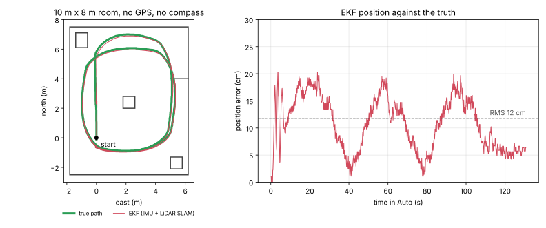

# Sensor fusion: IMU + LiDAR + GPS

**English** | [Tiếng Việt](SENSOR_FUSION.vi.md)

How the car combines its three position sensors (the MPU9250 IMU, the LD14 LiDAR and the
ZED-F9P GPS) into one better estimate of where it is. The guide also covers the new **LiDAR SLAM**,
which lets the car navigate indoors with no GPS at all.

- [1. Why combine sensors?](#1-why-combine-sensors)
- [2. How ArduPilot combines them: the EKF](#2-how-ardupilot-combines-them-the-ekf)
- [3. What's new: LiDAR SLAM](#3-whats-new-lidar-slam)
- [4. Indoors without GPS: set up](#4-indoors-without-gps-set-up)
- [5. How accurate is it?](#5-how-accurate-is-it)
- [6. Outdoors with RTK GPS](#6-outdoors-with-rtk-gps)
- [7. Indoors and outdoors on one switch (advanced)](#7-indoors-and-outdoors-on-one-switch-advanced)
- [8. Limits and troubleshooting](#8-limits-and-troubleshooting)
- [9. Test it on your PC](#9-test-it-on-your-pc)
- [10. Questions to go deeper](#10-questions-to-go-deeper)
- [Sources](#sources)

## 1. Why combine sensors?

No single sensor is good at everything. Each one is wrong in its own way, so each can
cover for the others.

| Sensor | Good at | Bad at | Example |
| --- | --- | --- | --- |
| **IMU** (MPU9250: gyro + accelerometer) | Very fast (1000×/s) and smooth; turning is measured almost perfectly over a second or two | It drifts. Position from the accelerometer alone is wrong by metres within seconds, and the gyro heading drifts degrees per minute | In the test below, the gyro alone would have drifted **54°** in 3 minutes |
| **GPS** (ZED-F9P) | Absolute position anywhere outdoors; RTK Fixed is ~1–2 cm | Only 5–10 updates a second, delayed ~0.1 s, and none indoors or under roofs and trees | In a warehouse: no fix at all |
| **LiDAR** (LD14) | Sees walls 360° at 6 rotations/s, ±1–2 cm | Only sees nearby things (8 m); in an open field it has nothing to see | A corridor or room: perfect. A football pitch: nothing to measure |
| **Compass** (in the MPU9250) | Absolute heading | Upset by motors, battery wires and steel (indoors especially) | Next to a steel shelf it can be wrong by 30° or more |

**Why combine?** The IMU fills the gaps *between* slow measurements, and the slow absolute
measurements (GPS outdoors, LiDAR indoors) stop the IMU from drifting.

*Example:* at 1 m/s, a GPS update every 0.2 s leaves 20 cm gaps. The IMU fills them in
smoothly, so the steering gets a fresh position on every main-loop cycle (50 times a
second on a Rover), not 5 times a second.

*Source:* ArduPilot, "Extended Kalman Filter (EKF)" [1].

## 2. How ArduPilot combines them: the EKF

ArduPilot uses an **Extended Kalman Filter (EKF3)**. It works in two steps, over and over:

1. **Predict** with the IMU: "I was here, going this fast, turning this much, so now I'm *there*."
   With every prediction the uncertainty grows.
2. **Correct** whenever a measurement arrives: "The GPS (or LiDAR) says I'm 8 cm further left."
   The EKF moves the estimate part of the way. How far depends on how much it trusts each one,
   and the uncertainty shrinks.

**Why not just use the latest measurement?** Because each measurement has noise. The EKF weighs
the measurement against the prediction by how uncertain each is.

*Example:* if the GPS reports ±2 cm (RTK Fixed) and the prediction is ±10 cm, the EKF follows the
GPS almost fully. If the GPS reports ±2 m (no RTK), it moves only a little.

**Measurements arrive late.** A GPS fix or a LiDAR scan describes the past: 50–200 ms ago. The
EKF keeps a short history and fuses each measurement at the moment it was taken, then replays
the IMU to now. This is why the time stamps and delay settings matter (section 4).

**Which sensor is used for what** is set by the *source* parameters [2]:

| Parameter | Meaning | Outdoors (GPS) | Indoors (LiDAR SLAM) |
| --- | --- | --- | --- |
| `EK3_SRC1_POSXY` | horizontal position | 3 = GPS | **6 = ExternalNav** |
| `EK3_SRC1_VELXY` | horizontal velocity | 3 = GPS | 0 = none |
| `EK3_SRC1_POSZ` | height | 1 = Baro or 3 = GPS | 6 = ExternalNav |
| `EK3_SRC1_YAW` | heading | 1 = Compass or 8 = GSF | **6 = ExternalNav** |

"ExternalNav" means a position and heading given to the EKF by something else. Normally that is a
companion computer (a camera or ROS). **In this firmware it is the LiDAR SLAM running on the
ESP32-S3 itself.**

## 3. What's new: LiDAR SLAM

**SLAM** = Simultaneous Localisation And Mapping: the car draws a map of the walls *and* finds
itself in that map, at the same time.

**Why is the plain LiDAR not enough?** Until now the LiDAR was used only to *avoid* obstacles
(`PRX1_TYPE` 19). It said "something is 1.2 m to the left", but never "you are at (3.4, 2.1)". SLAM
turns the same scans into a position.

How it works, once per rotation (about 6 times a second). The code is in
`libraries/AP_Proximity/LidarSlam.cpp` and `AP_Proximity_LD06.cpp`:

1. **Collect** one rotation: one point per degree, up to 360 points.
2. **Straighten (deskew).** The car moves during the 0.17 s rotation, so the scan is bent. The gyro
   (turning) and the car's speed (moving forward) are used to move every point to where it would
   have been seen at the end of the rotation.
   *Example:* at 1 m/s and turning 60°/s, the first point of a rotation is 17 cm and 10° off. Without
   this, walls would look curved.
3. **Match** the scan against the map (Gauss-Newton scan matching, the method of Hector SLAM [3]).
   It slides and turns the scan until its points lie on the walls already in the map. It works coarse
   to fine on three map resolutions: 40 cm, then 20 cm, then 10 cm. The gyro's turn since the last
   scan is the starting guess.
   *Why three resolutions?* A coarse map can pull in a scan that starts 30 cm off. The fine map
   then gives centimetre detail.
4. **Update the map** with the scan, but only after the car has moved 30 cm or turned 7°.
   *Why not every scan?* Adding the same view again and again, each time with a small error,
   smears the walls.
5. **Give the pose to the EKF** as ExternalNav: position, heading, the scan's time, and an
   uncertainty. The uncertainty grows when fewer points land on known walls (quality `Q`).

Points 2–4 run in their own thread so they never slow down the main loop (about 15–30 ms per
scan on the ESP32-S3). The map is 20 m × 20 m at 10 cm cells, which uses 53 KB of RAM.

**Fusion in one sentence:** the **IMU** predicts on every loop, the **gyro** straightens each scan and
gives the matcher its starting guess, the **LiDAR SLAM** corrects position *and* heading 6×/s, and
outdoors the **GPS** does the correcting instead.

## 4. Indoors without GPS: set up

1. **Flash** firmware built from this branch (README, *Build* and *Flash*).
2. **Load the parameters:** first `esp32s3_rover_ld14_f9p.parm` (if you haven't already), then
   [`esp32s3_rover_ld14_indoor.parm`](../esp32s3_rover_ld14_indoor.parm). Then set:
   - `PRX1_SLAM_LAT`, `PRX1_SLAM_LON`: your building's location (Google Maps → right-click →
     coordinates). This becomes the EKF origin, so maps and missions show the right place.
     *Why needed?* Without GPS the EKF has no origin, and Auto, Guided and RTL refuse to run.
   - `PRX1_SLAM_X`, `PRX1_SLAM_Y`: where the LiDAR sits relative to the ESP32 board, in metres
     (forward, right). *Example:* LiDAR 12 cm in front of the board: `PRX1_SLAM_X` 0.12.
3. **Reboot.** Put the car on a **start mark**, always facing the same way, and keep it still for
   about 5 s. In the Log tab (or Mission Planner Messages) you should see:
   ```
   SLAM: map 20 m, 0.10 m cells, 51 KB
   SLAM: started, heading 0
   SLAM: tracking
   SLAM: EKF origin 21.028511 105.804817
   EKF3 IMU0 is using external nav data
   ```
   *Why the same start mark?* The map is built fresh at every boot, starting where the car stands.
   That spot is (0, 0) and "north" is the way the car faces. A mission saved yesterday lands in the
   same place today only if you start from the same spot.
4. **First drive in Manual,** slowly. Watch the car's icon on the map: it should follow the car.
   Push it by hand around the room once, so the map covers the whole room.
5. **Then Auto:** plan a short mission inside the room (Plan tab), arm, Auto.

What to check in a log (`SLAM` message, `LOG_BACKEND_TYPE`=2 streams the log over MAVLink):

| Field | Meaning | Good |
| --- | --- | --- |
| `X`, `Y`, `Yaw` | position (m north and east of the start) and heading | follows the car |
| `Q` | share of scan points that land on known walls | > 0.8 |
| `M` | 1 = the scan matched the map | always 1 |
| `Map` | 1 = this scan was added to the map | now and then |
| `Drop` | scans skipped because the matcher was still busy | stays near 0 |
| `Age` | ms from the end of the scan to the EKF | < 80 |

**Why `EK3_FLOW_DELAY` 100?** Without GPS, the EKF's look-back window is only 60 ms. A SLAM pose
arrives 40–80 ms after its scan, so the EKF would fuse it as if it were newer than it is. Setting the
(unused) optical-flow delay to 100 ms widens the window. *Example:* at 1 m/s, a 40 ms error in
timing puts the position 4 cm behind.

To drive to places in a saved map from the phone (tap to go, patrols), see
[Indoor navigation in the apps](INDOOR_NAV.md).

## 5. How accurate is it?

Tested in ArduPilot's simulator (SITL): the real firmware, a simulated LD06 LiDAR in a 10 m × 8 m
room with a box, a cupboard, a chair and a short wall, and no GPS and no compass. The car drove
3 laps in Auto at 0.6 m/s:



| Test | Position error, RMS | Max | Heading error | Scans matched |
| --- | --- | --- | --- | --- |
| SITL, 3 laps in Auto, EKF output ([`sitl_indoor.py`](../Tools/lidar_slam_test/sitl_indoor.py)) | **10–14 cm** | 20–22 cm | < 1° | 100 % |
| Offline, 3 min of laps, LD14-like noise and dropouts, gyro bias 0.3°/s ([`test_slam.cpp`](../Tools/lidar_slam_test/test_slam.cpp)) | 7.7 cm | 14 cm | 1.8° | 100 % |
| Same, 10 min (14 laps) | 8.2 cm | 14 cm | 2.3° | 100 % |

**What this means:** about ±10 cm anywhere in the room, and it does **not** grow with time or
distance, because every scan is matched against the same map.
*Compare:* with the gyro and wheel speed alone (dead reckoning), heading drifts ~0.3°/s here, so
after 10 minutes the car would think north is 180° away.

**Be careful with these numbers:** a simulator is cleaner than a real room. A real LD14 sees
people walking, glass, black surfaces and chair legs. Expect it to be somewhat worse at first, and
check it with your own log (for example, drive back to the start mark and read `X`, `Y`).

## 6. Outdoors with RTK GPS

Outdoors the GPS does the correcting, so SLAM is not needed. Turn it off with `PRX1_SLAM` 0
(that also frees about 65 KB of RAM). LiDAR obstacle avoidance still works. With an RTK-fixed
ZED-F9P, these settings make the EKF trust the GPS as much as it deserves:

| Parameter | Value | Why | Source |
| --- | --- | --- | --- |
| `EK3_SRC1_POSXY` / `VELXY` | 3 / 3 | position and velocity from the GPS | [2] |
| `EK3_POSNE_M_NSE` | 0.1 (default 0.5) | This is the *smallest* GPS position error the EKF will assume. The EKF uses the GPS's own reported accuracy when it is larger, so lowering this lets RTK's 1–2 cm count. *Example:* at the default, RTK Fixed is still treated as ±50 cm | [1], `AP_NavEKF3_PosVelFusion.cpp` |
| `GPS1_POS_X`, `_Y`, `_Z` | antenna position, m (forward, right, down) from the board | Without it, turning moves the antenna sideways and the EKF sees it as the car sliding. *Example:* an antenna 20 cm behind the board swings 20 cm in a 90° turn | [4] |
| `EK3_SRC1_YAW` | 1 (compass) or **8 (GSF)** | GSF works out heading from GPS velocity while driving, so it needs no compass. Good when the motor upsets the MPU9250's compass | [5] |
| `WP_RADIUS` | 0.5 | With ±2 cm position, 0.5 m is realistic | README *Tuning* |

*Why not use SLAM outdoors too?* In an open space the LiDAR has few walls within 8 m, the scan
matches poorly, and the 20 m map would be outgrown in seconds. GPS is the right absolute
sensor there.

## 7. Indoors and outdoors on one switch (advanced)

The EKF can hold up to three *source sets* and switch between them while driving [2]. Load the
outdoor file, then set:

```
PRX1_SLAM       1       # SLAM runs all the time (reboot)
EK3_SRC1_POSXY  3       # set 1 = outdoors: GPS position, velocity, compass or GSF heading
EK3_SRC1_VELXY  3
EK3_SRC1_YAW    1       # or 8
EK3_SRC2_POSXY  6       # set 2 = indoors: LiDAR SLAM position and heading
EK3_SRC2_VELXY  0
EK3_SRC2_POSZ   6
EK3_SRC2_YAW    6
EK3_FLOW_DELAY  100
RC9_OPTION      90      # a 3-position switch on channel 9: low = set 1, middle = set 2
```

If the EKF already has a GPS position when SLAM starts (power on outdoors, wait for a fix, then
drive in), the map's (0, 0) is placed at that position, so both sets agree on where things are.
If SLAM starts first, the two sets disagree by however far the GPS origin is from the start. *Why advanced?* At the door you switch while the two sets
can disagree by tens of centimetres. Test it slowly, and switch only when the car is still.

## 8. Limits and troubleshooting

| Problem | Why | What to do |
| --- | --- | --- |
| `SLAM: out of memory` | The map doesn't fit in RAM (no PSRAM is used) | Smaller `PRX1_SLAM_SIZE` (15) or bigger cells (`PRX1_SLAM_CELL` 0.15) |
| `SLAM: lost` | Scans stopped matching: the car was lifted, spun fast, or the view is mostly people or glass | Hold, drive back to a known part by hand. If it doesn't recover, reboot on the start mark |
| Position jumps in a long corridor | A smooth corridor looks the same every metre along it, so SLAM can't tell how far along you are | Add something to see (boxes, door frames), or drive slower |
| Car leaves the map edge | The map covers only `PRX1_SLAM_SIZE`/2 around the start | Start in the middle of the area, or a bigger `PRX1_SLAM_SIZE` |
| Heading off after a very fast spin | The gyro gives the matcher its starting guess, but a spin of hundreds of °/s bends the scan more than the deskew can fix | Limit the turn rate, e.g. `ATC_STR_RAT_MAX` 90 |
| `Drop` keeps rising | The matcher takes longer than a rotation | Bigger cells, smaller map |
| Map is rebuilt each boot | By design: the map lives in RAM | Always start on the same mark |

## 9. Test it on your PC

Two tests, no car needed (Linux, or WSL on Windows):

```bash
# 1. The SLAM alone: a simulated LD14 in a room, ~10 s
cd Tools/lidar_slam_test
g++ -O2 -std=c++17 -I../../libraries/AP_Proximity test_slam.cpp \
    ../../libraries/AP_Proximity/LidarSlam.cpp -o test_slam && ./test_slam 600

# 2. The whole firmware in ArduPilot's simulator: 3 laps in Auto, no GPS
cd ../..
./waf configure --board sitl && ./waf rover
pip install pymavlink
python3 Tools/lidar_slam_test/sitl_indoor.py --laps 3
python3 Tools/lidar_slam_test/plot_run.py /tmp/slam_sitl_*/logs/00000001.BIN run.svg
```

`SIM_ROOM=1` (which `sitl_indoor.py` sets for you) swaps SITL's field of posts for the room.

## 10. Questions to go deeper

- Why does a wrong time stamp of only 50 ms matter at 1 m/s, and why doesn't it matter when the
  car is still?
- If the EKF trusts SLAM more (a smaller error), does the car get more accurate, or just more nervous?
  How would you see that in a log?
- Why can SLAM correct heading drift, but the IMU cannot correct itself?
- What happens to the match in a round room, or a long smooth corridor? Which direction can't be
  measured there, and why?
- Why does adding every scan to the map make the map *worse*?
- Outdoors, why can GPS velocity give a heading (GSF) only while the car moves?
- If a person walks next to the car, why doesn't SLAM think the wall moved? (Hint: how many of the
  360 points does a person cover?)
- When would it be worth saving the map to flash so that it survives a reboot? What could go wrong?

## Sources

1. ArduPilot, *Extended Kalman Filter (EKF)*: https://ardupilot.org/rover/docs/common-apm-navigation-extended-kalman-filter-overview.html
2. ArduPilot, *EKF Source Selection and Switching* (`EK3_SRCx_*`, ExternalNav = 6, `RCx_OPTION` 90): https://ardupilot.org/rover/docs/common-ekf-sources.html
3. S. Kohlbrecher, O. von Stryk, J. Meyer, U. Klingauf, *A Flexible and Scalable SLAM System with Full 3D Motion Estimation*, IEEE SSRR 2011 (Hector SLAM): https://doi.org/10.1109/SSRR.2011.6106777
4. ArduPilot, *Sensor Position Offset Compensation*: https://ardupilot.org/rover/docs/common-sensor-offset-compensation.html
5. ArduPilot, *Compass-less Operation* (`EK3_SRC1_YAW` = 8, GSF): https://ardupilot.org/rover/docs/common-compassless.html
6. ArduPilot source in this repo: `libraries/AP_NavEKF3/AP_NavEKF3_Measurements.cpp` (`writeExtNavData`: time stamps, look-back window), `AP_NavEKF3_core.cpp` (delay window), `AP_NavEKF3_PosVelFusion.cpp` (GPS noise floor)
7. LDROBOT LD14 development manual and SDK (scan rate, range, packet format), as used in `AP_Proximity_LD06.cpp`
